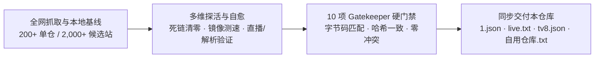

<div align="center">


# 🐯 牛虎 ┃ TVBox 全功能精选订阅

**豆瓣海报开屏 · 免登秒播置顶 · 全域极速聚搜 · 本地最新 JAR 自托管**

[](https://github.com/niubihu1/tvbox)
[](./1.json)
[](./1.json)
[-orange?style=flat-square)](./live.txt)
[](./1.json)

[🚀 订阅地址](#-订阅地址) · [📊 接口构成](#-接口构成) · [🛡️ 工程保障](#️-工程保障) · [📥 客户端下载](#-客户端下载) · [📖 导入教程](#-三步导入) · [💡 常见问题](#-常见问题)

</div>

<p align="center">
  汇总筛选全网 <b>2,000+</b> 候选接口，经本地实测测速与 <b>10 项门禁校验</b> 剔除死链与失效源，精简保留开箱即用配置。<br>
  站源与底座致谢：感谢 <b>肥猫、饭太硬、摸鱼、王小二、EasyTV、俊于、道长、心魔</b> 等一线大仓作者的持续维护与无私分享。
</p>

---

## 🚀 订阅地址

> [!TIP]
> 每个代码框右上角均自带 **一键复制按钮**。日常观影只需复制下方 **主力单仓接口**，粘贴到播放器 **「设置 ➔ 配置地址」** 确定即可。

### 🎯 主力单仓（日常观影首选）

推荐默认主线（`gh-proxy` 国内毫秒级加速 · 点播 / 直播 / 4K 网盘一站全包）：

```text
https://gh-proxy.com/https://raw.githubusercontent.com/niubihu1/tvbox/main/1.json
```

### 🧩 扩展接口（按需选用）

* **📦 精选多仓聚合**（[`tv8.json`](./tv8.json) · 16 线 · 适用 影视仓 TV / 月光宝盒 / FongMi 多仓）
  ```text
  https://gh-proxy.com/https://raw.githubusercontent.com/niubihu1/tvbox/main/tv8.json
  ```

* **🪜 主流大仓天梯**（[`自用仓库.txt`](./自用仓库.txt) · 22 线全网仓合集）
  ```text
  https://gh-proxy.com/https://raw.githubusercontent.com/niubihu1/tvbox/main/自用仓库.txt
  ```

* **📺 独立电视直播**（[`live.txt`](./live.txt) · 2,076 条直播流 · 适用 TVBox / TiviMate / APTV / PotPlayer）
  ```text
  https://gh-proxy.com/https://raw.githubusercontent.com/niubihu1/tvbox/main/live.txt
  ```

### 🌐 备用加速节点与 GitHub 原始直连

* **备用加速线路（ghfast 节点）**（[`1.json`](./1.json)）：
  ```text
  https://ghfast.top/https://raw.githubusercontent.com/niubihu1/tvbox/main/1.json
  ```

* **GitHub 原始直连（无加速前缀，适合海外网络或透明代理）**：
  * `1.json`（单仓主力）
    ```text
    https://raw.githubusercontent.com/niubihu1/tvbox/main/1.json
    ```
  * `tv8.json`（精选多仓）
    ```text
    https://raw.githubusercontent.com/niubihu1/tvbox/main/tv8.json
    ```
  * `自用仓库.txt`（主流大仓天梯）
    ```text
    https://raw.githubusercontent.com/niubihu1/tvbox/main/自用仓库.txt
    ```
  * `live.txt`（独立直播）
    ```text
    https://raw.githubusercontent.com/niubihu1/tvbox/main/live.txt
    ```

---

## 📊 接口构成

基于 `EasyTV`（`easy11.14.png`）+ `aowu.png` 双核 DEX 底座，从全网 **200+** 存活单仓、**2,000+** 候选站源中自动测活、去重与剔除死链后组装而成：

| 模块 | 当前规格 | 核心说明 |
| :--- | :--- | :--- |
| **点播站源** | **172 站**（159 可搜 / 138 聚搜） | 在线免登 **97** + 4K 网盘 **32** + 无广告 CMS 采集 **22** + 特色专区 **21** |
| **首屏排位** | **豆瓣开屏 + 配置中心 + 秒播连环阵** | `#0 豆瓣热播`、`#1 配置中心`、`#2 厂长影视` + 嗷呜 11 条秒播专线 |
| **Spider 核心** | **`easy11.14.png` + `aowu.png` 自托管** | 最新本地包托管于本仓库并附 `;md5;` 指纹，免疫外链图床删档 404 |
| **电视直播** | **14 路直播列表** / [`live.txt`](./live.txt) 2,076 流 | 含 **9 路实测可用公网直播** + 5 路本地飞羊（`127.0.0.1:35457`），带 EPG/台标 |
| **视频解析** | **15 路** | 首位通用 `Web` 聚合 + **14 路测速优选解析**（已自动过滤失效 `type: 1` 接口） |
| **观影配套** | **弹幕 + 去广告 + DoH** | 原生 `9978` 实时弹幕、**6 条**去广告切片规则、**7 组**抗污染 DoH |
| **工程兼容** | **零重复 Key · 零相对路径 · 全 ASCII URL** | `dupK=0`、`rel=0`、`nonAsc=0`，老旧盒子 OkHttp 稳定加载不崩溃 |

---

## 🛡️ 工程保障



### 🔒 Gatekeeper 10 项自动化门禁铁律

| 规则 | 检查项 | 守护内容 |
| :---: | :--- | :--- |
| **Rule 1** | **JSON 与唯一 Key** | 校验 `1.json` / `tv8.json` 合法性，严禁站点 Key 重复与 Git 冲突标记残留 |
| **Rule 2** | **首页导航与配置中心** | `#0` 必须为豆瓣热播且禁用 `filterable: 0`，`#1` 严格绑定配置中心 |
| **Rule 3** | **直播源完整性** | 校验官方综合 + 5 大飞扬及 `live.txt` 分类与有效流数量（剔除恶意劫持主机） |
| **Rule 4** | **免登秒播置顶** | 前 20 席位严禁被需扫码网盘源挤占，保证老人小孩开箱即点即播 |
| **Rule 5** | **4K 网盘防越界** | 主流网盘源完备，`ext.site` 严禁空数组与已知死链域名 |
| **Rule 6** | **嗷呜专线与聚搜率** | 嗷呜 11 条专线全开搜索，强制要求全站 `>= 100` 站同时开启搜索/快搜/换源 |
| **Rule 7** | **DEX 字节码零缺失** | 逐一核对站点 `api` 与本地 `easy` / `aowu` JAR 内的真实类名，杜绝 `ClassNotFound` |
| **Rule 8** | **Spider 指纹校验** | 强制检验 `spider` 的 `;md5;` 与本地物理 JAR 文件严格一致 |
| **Rule 9** | **纯净链路与编码** | 严禁多层代理嵌套、XBPQ 冗余外挂 Jar 与未 Punycode 转义的非 ASCII URL |
| **Rule 10** | **防闪退根结构与配套** | 严格 12 个标准根字段（剥离 `hosts`/`headers`），核验弹幕、规则、解析、DoH 与 Logo |

---

## 📥 客户端下载

> 安装包均指向开源原版或社区搬运公开仓库，按设备架构（电视多为 32 位 `armeabi_v7a`、新盒子/手机多为 64 位 `arm64_v8a`）按需下载即可。

### 📺 电视 TV / 盒子端

| 播放器 | 推荐版本 | 特点 | 下载地址 |
| :--- | :---: | :--- | :--- |
| **FongMi 影视 (蜂蜜)** | `v5.8.8` | 开源口碑首选，原生 TV 架构、流畅且支持杜比 | [32位通用](https://gh-proxy.com/https://github.com/FongMi/Release/releases/download/5.8.8/leanback-armeabi_v7a.apk) ｜ [64位](https://gh-proxy.com/https://github.com/FongMi/Release/releases/download/5.8.8/leanback-arm64_v8a.apk) ｜ [夸克](https://pan.quark.cn/s/b55be5547a68) ｜ [UC](https://drive.uc.cn/s/f8e067cede5f4?public=1) |
| **TVBox Takagen99** | `20260227` | 轻量低内存，老旧安卓盒子兼容性好 | [32位通用](https://gh-proxy.com/https://raw.githubusercontent.com/youhunwl/TVAPP/main/TVBox/TVBox_takagen99_20260227-1116-armeabi-generic-java.apk) ｜ [64位](https://gh-proxy.com/https://raw.githubusercontent.com/youhunwl/TVAPP/main/TVBox/TVBox_takagen99_20260227-1116-arm64-generic-java.apk) |
| **月光宝盒 Max** | `20260926` | 界面美观，支持单仓/多仓切换 | [APK直链](https://gh-proxy.com/https://raw.githubusercontent.com/youhunwl/TVAPP/main/%E5%BD%B1%E8%A7%86/%E6%9C%88%E5%85%89%E5%AE%9D%E7%9B%92/%E6%9C%88%E5%85%89%E5%AE%9D%E7%9B%92Max1017.apk) ｜ [夸克](https://pan.quark.cn/s/a2c78537f5df) ｜ [UC](https://drive.uc.cn/s/a993aa79c6984?public=1) |
| **影视仓 原版 TV** | `v6.2.9` | 原生支持多仓与 `tv8.json` 聚合切换 | [32位通用](https://gh-proxy.com/https://raw.githubusercontent.com/youhunwl/TVAPP/main/%E5%BD%B1%E8%A7%86/%E5%BD%B1%E8%A7%86%E4%BB%93/%E5%BD%B1%E8%A7%86%E4%BB%93-TV6.2.9-32%E4%BD%8D.apk) ｜ [64位](https://gh-proxy.com/https://raw.githubusercontent.com/youhunwl/TVAPP/main/%E5%BD%B1%E8%A7%86/%E5%BD%B1%E8%A7%86%E4%BB%93/%E5%BD%B1%E8%A7%86%E4%BB%93-TV6.2.9-64%E4%BD%8D.apk) ｜ [百度(a6g7)](https://pan.baidu.com/s/11RcWwauUQiWt_Ids_zs5Qw?pwd=a6g7) ｜ [夸克](https://pan.quark.cn/s/61d324167c07#/list/share) |

### 📱 手机 / 平板端

| 播放器 | 推荐版本 | 特点 | 下载地址 |
| :--- | :---: | :--- | :--- |
| **FongMi 影视 手机版** | `v5.8.8` | 触控手势、画中画与一键投屏体验最佳 | [64位](https://gh-proxy.com/https://github.com/FongMi/Release/releases/download/5.8.8/mobile-arm64_v8a.apk) ｜ [32位](https://gh-proxy.com/https://github.com/FongMi/Release/releases/download/5.8.8/mobile-armeabi_v7a.apk) ｜ [夸克](https://pan.quark.cn/s/b55be5547a68) ｜ [UC](https://drive.uc.cn/s/f8e067cede5f4?public=1) |
| **影视仓 手机平板优化版** | `v3.3.9` | 适配手机/平板横竖屏，支持多仓管理 | [APK直链](https://gh-proxy.com/https://raw.githubusercontent.com/youhunwl/TVAPP/main/%E5%BD%B1%E8%A7%86/%E5%BD%B1%E8%A7%86%E4%BB%93/%E5%BD%B1%E8%A7%86%E4%BB%93-%E6%89%8B%E6%9C%BA%E5%B9%B3%E6%9D%BF3.3.9-64%E4%BD%8D.apk) ｜ [百度(a6g7)](https://pan.baidu.com/s/11RcWwauUQiWt_Ids_zs5Qw?pwd=a6g7) |

---

## 📖 三步导入

1. **打开设置**：打开电视端 **FongMi / TVBox / 影视仓**，进入 **「设置」➔「配置地址」**；
2. **手机扫码推送**（免遥控器打字）：保证手机与电视同一 Wi-Fi，用手机微信/浏览器扫描屏幕二维码（或访问页面显示的 `http://192.168.x.x:9978`）；
3. **填入接口并确定**：粘贴上方主线地址并点击确定：
   ```text
   https://gh-proxy.com/https://raw.githubusercontent.com/niubihu1/tvbox/main/1.json
   ```

---

## 💡 常见问题

**Q1：播放偶发卡顿、只有声音没画面，或提示解码失败？**
* 在播放器 **「设置 ➔ 解码设置」** 中，将默认播放器或解码模式在 **IJK 硬解 / EXO** 之间切换尝试；4K 高码率片源建议优先开启硬解。

**Q2：如何使用 4K 原画网盘源（阿里 / 夸克 / UC）？**
* 切到首页第 2 位 **`🐯牛虎 ┃ 配置中心`**，用手机对应网盘客户端扫码登录授权一次即可全盘通用。

**Q3：提示“无法获取配置 / 下载超时”怎么办？**
* 运营商偶发污染 DNS 时，可将电视 Wi-Fi 的 DNS 改为 `223.5.5.5` 或 `119.29.29.29`；
* 也可切换为备用加速线路（ghfast 节点）：`https://ghfast.top/https://raw.githubusercontent.com/niubihu1/tvbox/main/1.json`。

**Q4：找不到极冷门老剧怎么办？**
* 默认全站已有 **138** 个开启聚搜的站点；如前排未命中，可继续向下滚动或直接启用排在后面的 **CMS 采集专区（暴风 / 红牛 / 量子 / 非凡等）**，或切至多仓列表 [`自用仓库.txt`](./自用仓库.txt) 中的其他线路补充。

---

## ⚖️ 免责声明

* 本项目所有配置、规则、解析与接口链接均整理自公开网络与开源社区，仅作个人技术研究与多媒体协议学习交流；
* 本仓库不制作、不存储任何音视频文件，亦不参与任何商业收费行为；如有版权或侵权问题请通过 Issue 联系删除。

<div align="center">

🌟 如果觉得好用，欢迎点亮右上角 **Star** 支持！

</div>
